# Bot Operations Portal

**How I designed a portal where non-technical team leads run their department's AI agents (hours, knowledge, announcements, catalog, problem reports) without a developer, and without the agents ever depending on a slow admin path.**

Every company that puts several AI agents in front of customers hits the same wall. The agents work, but every operational change goes through the one person who built them: "we close early on Friday", "add this tour", "the bot told a customer something wrong". Configuration ends up hard-coded and copied across workflows, and the builder becomes the bottleneck.

This repo is the design of the system that removed that bottleneck: the architecture, the data model, the decisions and the mistakes. The production code belongs to my employer and isn't here. The ideas transfer to any stack.

---

## The shape

```mermaid
flowchart LR
  subgraph People
    TL[Team leads<br/>he / ar / en]
    AD[Admin]
  end
  subgraph Portal["Portal (static SPA)"]
    UI[Forms generated<br/>from module schemas]
  end
  subgraph DB["Postgres + Auth + Storage"]
    RPC[RPCs<br/>submit / review / rollback]
    CV[(config_versions)]
    LC[(live_config)]
    RQ[(requests)]
    OB[(outbox)]
    RT[bot_runtime&#40;bot&#41;<br/>resolved config +<br/>is_open_now / next_open]
  end
  subgraph Bots["Agents (workflow engine)"]
    B1[Agent 1]
    B2[Agent 2]
    AS[Async jobs<br/>notify / triage]
  end
  TL --> UI --> RPC --> CV --> LC
  AD --> UI
  UI --> RQ
  RPC --> OB --> AS
  B1 -- "one keyed read per turn" --> RT
  B2 -- "one keyed read per turn" --> RT
  LC --> RT
```

Three rules hold it together:

1. **The portal knows modules, not bots.** A bot declares which modules it has (hours, knowledge base, announcements, kill switch, handoff, requests). Adding a bot is data, not development.
2. **The database is the security boundary.** Every permission is enforced by row-level security and server-side functions. The UI is a convenience, never a gate.
3. **The agents' hot path is one primary-key read.** The portal's traffic never touches the workflow engine that runs the agents.

---

## Status

| Live | Next |
|---|---|
| Schema, permissions, Google SSO, three-language UI | Live agents switch to the runtime call one by one |
| The product catalog, used daily by its team lead, with generated brochures | Outbox consumers: notifications, AI triage of reports |
| Problem reports with phone, time and screenshots | Catalog approval rule moved onto the module policy |
| Sandbox bot reading its config through the runtime contract with its own key | |

---

## Contents

| # | Chapter | What's inside |
|---|---|---|
| 1 | [The Problem and the Requirements](docs/01-problem-and-requirements.md) | Hard-coded config in many copies, the builder as bottleneck, what "done" had to mean |
| 2 | [Modules, Not Bots](docs/02-modules-not-bots.md) | Module manifests, schema-driven forms, approval policy as data |
| 3 | [The Config Lifecycle](docs/03-config-lifecycle.md) | Versions, drafts, approval, one-live guarantee, rollback, audit |
| 4 | [The Runtime Contract](docs/04-runtime-contract.md) | What an agent reads each turn, computed opening hours, per-bot keys, fallback |
| 5 | [Permissions in the Database](docs/05-permissions-in-the-database.md) | RLS, security-definer RPCs, and the default grants that almost bit |
| 6 | [Requests and the Outbox](docs/06-requests-and-outbox.md) | Problem reports with evidence, async events without coupling |
| 7 | [Shipping to Non-Developers](docs/07-shipping-to-non-developers.md) | Three languages and RTL, a sandbox bot, "what the bot sees", loosening rules from real use |

---

## Stack

Postgres with row-level security, built-in auth (Google SSO) and object storage · a React + TypeScript SPA on a static host · the existing workflow engine (n8n) for the agents and for async jobs only.

The choice of a managed Postgres over a document database was deliberate: auth, row-level permissions and file storage come built in, so a single engineer can run it without building and securing an API server. See [chapter 5](docs/05-permissions-in-the-database.md).

## Key decisions

| Decision | Why |
|---|---|
| Separate frontend + database, not pages served by the workflow engine | The engine was already under load. Admin traffic must not compete with customer conversations |
| Approval policy stored per module, not in code | Start strict (everything needs approval), loosen per module as trust grows, without a deploy |
| Opening hours computed in the database | One implementation of "are we open now / when do we open next" instead of one per bot |
| Per-bot keys, stored hashed | A leaked key exposes one bot's read-only config, never the database |
| Outbox table for events | The portal never calls the workflow engine directly. If it's down, events wait |
| Data-first catalog | Staff edit structured fields. Brochures (PDF) are generated from them, so the agent and the brochure can't disagree |

---

## About

Written by **Ido Guy**, AI & Automation Engineer. I design end-to-end AI solutions for sales and operations teams. [LinkedIn](https://www.linkedin.com/in/ido-guy)

Also: [WhatsApp AI Agent Design](https://github.com/123idog/whatsapp-ai-agent-design) · [n8n Production Playbook](https://github.com/123idog/n8n-production-playbook) · [LLM Evaluation in Production](https://github.com/123idog/llm-evaluation-in-production)

*Architecture and lessons only. No production code, data, names or identifiers are included.*
