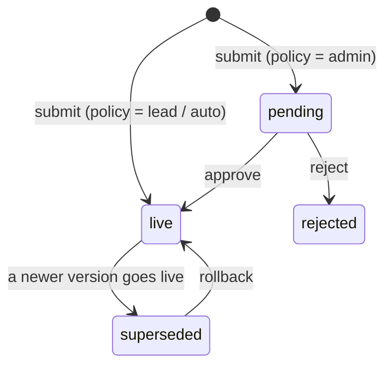

# 3. The Config Lifecycle

Every change to a module creates a **version**. Nothing is edited in place.



```text
config_versions   bot_id, module, version, base_version, status, data, note,
                  submitted_by, submitted_at, reviewed_by, reviewed_at
live_config       bot_id, config (all live modules merged), updated_at
audit_log         actor, action, entity, entity_id, before, after, at
```

## Rules enforced by the database

- **One live version per bot and module**, guaranteed by a partial unique index (`where status = 'live'`), not by application code. Two approvals racing can't produce two live versions.
- **`base_version`** records which live version a draft started from. If someone else's change went live in between, the reviewer sees that the draft is based on an outdated version and the diff is against the current one.
- **Changes go through functions** (`submit_config`, `review_config`, `rollback_config`). Clients cannot insert or update versions directly. The functions check the caller's role, the module's policy and the data shape, then write the version, the audit row and an outbox event in one transaction.
- **Rollback is a new transition**, not a delete. History is never rewritten.

## Materialize what the agent reads

When a version goes live, the function rebuilds `live_config` for that bot: one row with every live module merged. The agent reads that one row ([chapter 4](04-runtime-contract.md)). Versions, reviews and history are for people. The agent never joins across them.

## The review screen

The reviewer sees the current live value and the proposed one side by side, with the submitter's note. Approve or reject with a comment. Every action lands in the audit log.

## Lessons

- **Test the permission logic inside the database**, in transactions that roll back. Every function had tests like "a team lead of another department gets `forbidden`", "a second live version is impossible", run against the real schema and leaving no data behind.
- **Watch `NULL` in permission checks.** In PL/pgSQL, `if not (is_admin or NULL)` does not raise when the user is not an admin, because `not NULL` is `NULL`, which `if` treats as false. A role helper that returned `NULL` for an unknown user silently let the check pass. Every boolean check is wrapped in `coalesce(..., false)`.
